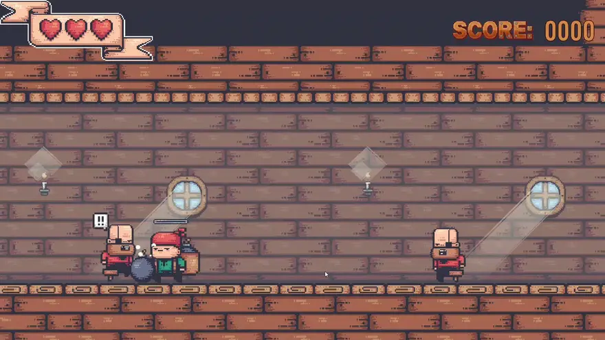
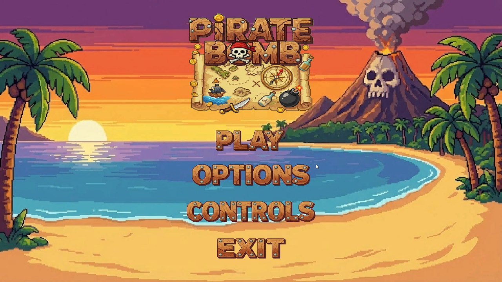
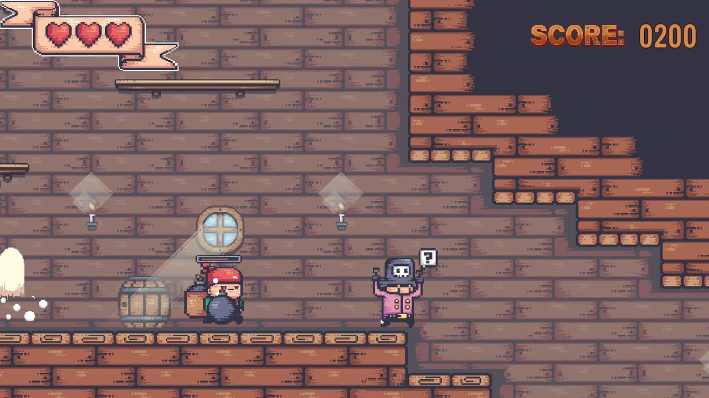
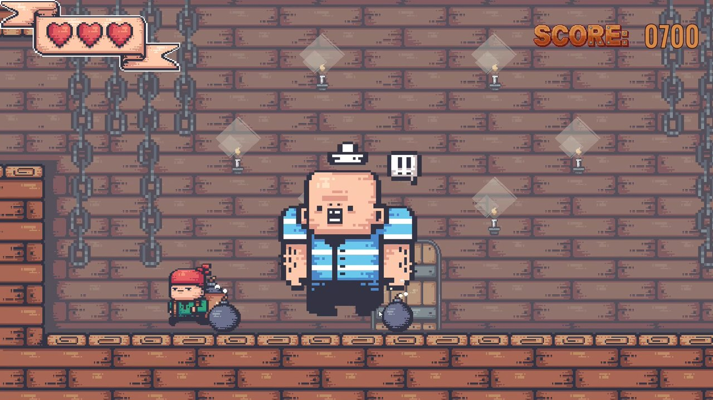

<div align="center">

# 💣 Pirate Bomb

**Plataformas 2D de piratas en el que lanzas bombas cargando la fuerza del tiro, esquivas enemigos que huyen de las explosiones y buscas la llave para abrir la puerta de salida**

[]()
[]()
[]()
[]()

</div>

---

## 📖 Sobre el proyecto

Un plataformas 2D con una mecánica central: **la bomba**. No se dispara, se lanza, y tú decides con cuánta fuerza manteniendo pulsado el botón. Explota unos segundos después de tocar el suelo, y los enemigos reaccionan a ello. Hay dos niveles, un menú principal (*Play*, *Options*, *Controls* y *Exit*) y una pantalla de carga entre escenas.

> 📌 **Proyecto académico** del *Máster en Diseño y Desarrollo de Videojuegos* de la **UNIR**, hecho con Unity 6. El curso también incluyó un plataformas distinto hecho con Unreal Engine: [UnaiGB_UNIR_Plataformas2D](https://github.com/unaigb/UnaiGB_UNIR_Plataformas2D).

---

## 🖼️ Capturas

<p align="center">
  
</p>

<p align="center">
  
  
  
</p>

<p align="center"><em>Menú principal y dos momentos de una partida, con las vidas arriba a la izquierda y la puntuación a la derecha.</em></p>

---

## 🎮 Cómo se juega

- **Corre y salta** por el nivel. Tienes **3 vidas** y, tras recibir un golpe, un breve periodo de invulnerabilidad.
- **Lanza bombas.** Mantén pulsado el ataque para cargar la fuerza (una barra lo muestra) y suéltalo para lanzar. La bomba cae, y unos 3 segundos después de tocar el suelo explota: hace **1 de daño**, o **2 si el enemigo está muy cerca**.
- **Los enemigos no son todos iguales.** Cada uno se configura como agresivo o miedoso, y puede saltar obstáculos para perseguirte. Los miedosos **huyen de las bombas** que caen cerca.
- **Consigue la llave.** Uno de los enemigos la lleva y la suelta al morir. Las puertas de salida de algunos niveles exigen la llave y, a veces, haber derrotado a un jefe.
- **Cruza la puerta** para pasar al siguiente nivel. Los enemigos dan puntos al caer (100 por defecto) y la puntuación y las vidas se conservan entre niveles.

### 🕹️ Controles

| Acción | Teclado y ratón | Mando |
| :--- | :---: | :---: |
| Moverse | `A` `D` o flechas | Stick izquierdo |
| Saltar | `Espacio` | `A` |
| Lanzar bomba (mantener para cargar) | Clic izquierdo o `Intro` | Gatillo derecho |
| Interactuar (puertas) | `E` | `Y` |

---

## ✨ Qué incluye

- **Lanzamiento con fuerza variable**, con barra de carga y enfriamiento entre bombas.
- **IA de enemigos configurable**: agresivo o miedoso, con o sin salto, con radios de detección y de ataque, y reacciones animadas de alerta y de miedo.
- **Puertas de entrada y de salida** con animación, que colocan al jugador al llegar y piden requisitos al salir.
- **Dos niveles**, menú principal, menú de opciones y pantalla de carga.
- **Música de fondo** que se mantiene entre escenas.
- **Cámara con Cinemachine** que sigue al jugador.

---

## 🚀 Cómo ejecutarlo

**Requisitos:** [Unity Hub](https://unity.com/download) y el editor **Unity 6000.2.7f2**.

1. En Unity Hub, *Add → Add project from disk* y elige la raíz de este repositorio.
2. Abre el proyecto con el editor 6000.2.7f2 (la primera vez tarda en importar los assets).
3. Abre la escena `Assets/Scenes/Menu.unity` y pulsa **Play**.

No hay una versión compilada publicada.

---

## 🔧 Detalles técnicos

- **`GameManager` persistente** (`DontDestroyOnLoad`) que lleva las vidas, la puntuación, la llave del inventario y la música, y evita duplicarse al volver a cargar una escena.
- **La bomba como máquina de eventos:** una corrutina cuenta atrás desde que toca el suelo, activa un *trigger* durante un instante para aplicar el daño y se destruye tras la animación de explosión.
- **Enemigos por parámetros** (`EnemyBehaviour`): el mismo script sirve para soldados agresivos, enemigos miedosos o el portador de la llave según cómo se configure en el Inspector.
- **Entrada con el nuevo Input System** y cámara con Cinemachine 3.

---

## 📂 Estructura del repositorio

```
UNIR_Plataformas2D/
├── Assets/
│   ├── Scenes/            # Menu, Level1 y Level2
│   ├── Scripts/           # Jugador, bomba, enemigos, puertas, GameManager y menús
│   ├── Animations/ · Animators/ · Prefabs/
│   ├── Tilemap/           # Tiles de los niveles
│   ├── Pirate Bomb/       # Arte del juego
│   └── Sounds/ · Images/
├── Media/                 # Capturas y animación del juego
├── Packages/
└── ProjectSettings/
```

---

## 🖥️ Stack tecnológico

| Categoría | Herramientas |
| :--- | :--- |
| **Motor** | Unity 6 (6000.2.7f2) con Universal Render Pipeline 2D |
| **Lenguaje** | C# |
| **Paquetes** | Input System · Cinemachine · TextMesh Pro · Tilemap |

---

## 🎨 Créditos de terceros

Este repositorio incluye el pack de arte *Pirate Bomb* (carpeta `Assets/Pirate Bomb/`) y otros recursos de terceros, que conservan sus propias licencias.

---

## 👤 Autoría

**Unai García** — Máster en Diseño y Desarrollo de Videojuegos (UNIR)

- 🐙 GitHub: [@unaigb](https://github.com/unaigb)
- 🌐 Portfolio: [unaigb.dev](https://unaigb.dev)
